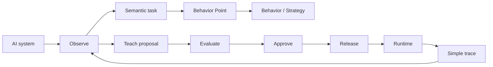
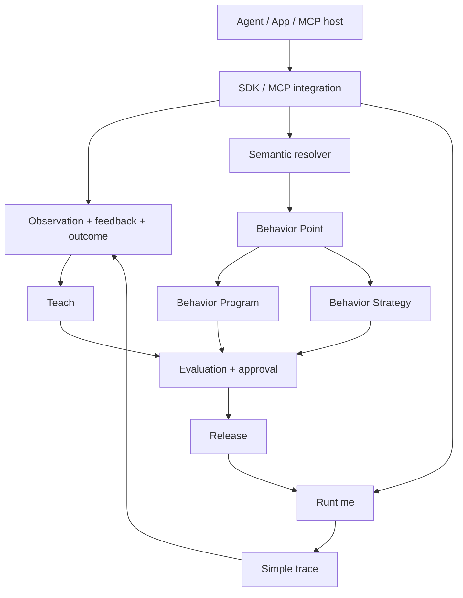

<p align="center">
  <strong>Vira</strong>
</p>

<h1 align="center">Behavior control for AI systems</h1>

<p align="center">
  Turn repeated corrections into behavior you can observe, review, evaluate, release, resolve, and trace.
</p>

<p align="center">
  
  
  
  
  
</p>

<p align="center">
  <a href="#quickstart">Quickstart</a> ·
  <a href="docs/README.md">Docs</a> ·
  <a href="docs/reference/javascript-sdk.md">JavaScript SDK</a> ·
  <a href="docs/reference/python-sdk.md">Python SDK</a> ·
  <a href="docs/reference/mcp.md">MCP</a> ·
  <a href="docs/reference/mcp-tools.md">MCP tools</a> ·
  <a href="tutorials/marketing-agent/README.md">Tutorial</a>
</p>

---

## One correction should not become another hidden prompt

A useful AI system gets corrected constantly.

A launch plan misses retention.  
A support agent escalates too late.  
A research assistant mixes sourced claims with inference.  
A tool-using agent tries an action that needs approval.

Most teams solve each case by adding another instruction somewhere.

Vira gives those corrections a governed lifecycle instead.



> **AI can propose. Released behavior remains explicit.**

Semantic selection is not authorization.  
Observation is not authority.  
A Teach proposal is not a production release.

---

## What Vira controls

| Layer | What it answers | Example |
| --- | --- | --- |
| **Semantic Task** | What kind of work is this? | `marketing.launch_plan` |
| **Behavior Point** | Where should governed behavior attach? | `marketing.launch_plan` |
| **Signals** | What typed evidence matters? | `quality.missing_measurement` |
| **Behavior Program** | What should be guarded, judged, transformed, verified, or escalated? | full-funnel requirement |
| **Strategy** | How should a bounded multi-step task proceed? | draft → verify → compose |
| **Evaluation** | Did the candidate pass the required checks? | full funnel + measurement |
| **Release** | Which approved behavior is eligible for runtime? | released revision |
| **Runtime** | What governed behavior applies now? | resolved Behavior Point |
| **Trace** | What was selected and applied? | task + behavior + result |

---

## Quickstart

### JavaScript / TypeScript

```bash
npm install @vira/sdk
```

```ts
import { ViraClient } from "@vira/sdk";

const vira = new ViraClient({
  baseUrl: process.env.VIRA_API_URL!,
  apiKey: process.env.VIRA_API_KEY,
});

const connected = await vira.connectOnce({
  name: "marketing-agent",
  systemType: "custom-agent",
  organizationId: process.env.VIRA_ORGANIZATION_ID!,
  projectId: process.env.VIRA_PROJECT_ID!,
  environmentId: process.env.VIRA_ENVIRONMENT_ID!,
  adapterType: "custom-node",
  adapterVersion: "1",
  idempotencyKey: "connect:marketing-agent:v1",
});
```

Then resolve a governed task:

```ts
const semantic = await vira.resolveSemantic({
  input: "Build a launch plan for a membership product",
  profile: { domain: "marketing" },
});
```

And resolve released runtime behavior:

```ts
const runtime = await vira.resolveRuntime({
  behaviorPoint: "marketing.launch_plan",
  executionBoundary: {
    organizationId: process.env.VIRA_ORGANIZATION_ID!,
    projectId: process.env.VIRA_PROJECT_ID!,
    environmentId: process.env.VIRA_ENVIRONMENT_ID!,
  },
  idempotencyKey: crypto.randomUUID(),
});
```

**Full reference:** [JavaScript SDK](docs/reference/javascript-sdk.md)

### Python

```bash
python -m pip install vira-sdk
```

```python
import os
from vira import ViraClient

scope = {
    "organizationId": os.environ["VIRA_ORGANIZATION_ID"],
    "projectId": os.environ["VIRA_PROJECT_ID"],
    "environmentId": os.environ["VIRA_ENVIRONMENT_ID"],
}

with ViraClient(
    os.environ["VIRA_API_URL"],
    api_key=os.environ.get("VIRA_API_KEY"),
) as client:
    connected = client.connect_once(
        "marketing-agent",
        "custom-agent",
        scope,
        "custom-python",
        "1",
        idempotency_key="connect:marketing-agent:v1",
    )
```

**Full reference:** [Python SDK](docs/reference/python-sdk.md)

### MCP

```bash
npx -y @vira/mcp
```

Generic MCP client configuration:

```json
{
  "mcpServers": {
    "vira": {
      "command": "npx",
      "args": ["-y", "@vira/mcp"],
      "env": {
        "VIRA_API_URL": "https://api.example.com",
        "VIRA_API_KEY": "<api-key>",
        "VIRA_MCP_AUTH_TOKEN": "<mcp-auth-token>",
        "VIRA_MCP_AUTHORITY_URL": "https://api.example.com/v1/mcp/authorize",
        "VIRA_ORGANIZATION_ID": "<organization>",
        "VIRA_PROJECT_ID": "<project>",
        "VIRA_ENVIRONMENT_ID": "<environment>"
      }
    }
  }
}
```

The MCP server exposes governed tools for semantic resolution, runtime, Signals, Behavior Programs, Strategies, observations, discovery, evaluation, Packs, and Strategy execution.

**References:** [MCP setup](docs/reference/mcp.md) · [MCP tool catalog](docs/reference/mcp-tools.md)

> [!NOTE]
> Package publication is managed separately from this repository. The public package names are `@vira/sdk`, `@vira/mcp`, and `vira-sdk`; registry availability can lag the documentation release.

---

## Pick a path

| I want to… | Start here |
| --- | --- |
| Understand Vira in 5 minutes | [What is Vira?](docs/what-is-vira.md) |
| Connect an existing agent | [Connect an AI system](docs/guides/connect-an-ai-system.md) |
| Create a Behavior Point | [Behavior Points](docs/behavior-points.md) |
| Create and review Signals | [Signals](docs/signals.md) |
| Route requests semantically | [Semantic routing](docs/semantic-routing.md) |
| Author behavior | [Behavior Programs](docs/behavior-programs.md) |
| Build multi-step behavior | [Strategies](docs/strategies.md) |
| Learn from evidence | [Teach](docs/teach.md) |
| Evaluate and release | [Evaluation](docs/evaluation-and-approval.md) · [Release](docs/release.md) |
| Integrate with JavaScript | [JavaScript SDK reference](docs/reference/javascript-sdk.md) |
| Integrate with Python | [Python SDK reference](docs/reference/python-sdk.md) |
| Connect an MCP host | [MCP reference](docs/reference/mcp.md) |
| See every MCP tool | [MCP tool catalog](docs/reference/mcp-tools.md) |
| Follow one complete example | [Marketing Agent tutorial](tutorials/marketing-agent/README.md) |

---

## Developer surface

### SDK

The public clients cover more than connect-and-observe.

| Area | JavaScript / TypeScript |
| --- | --- |
| Connections | `connectSystem`, `connectAdapter`, `connectOnce`, `connectionHealth`, `testConnection`, `inventory` |
| Observations | `observe`, `trace`, `feedback`, `outcome`, `observeBatch`, `observeSdk`, `discover` |
| Signals | discovery proposal, review, materialization, mapping create/read/review |
| Semantic + Runtime | `resolveSemantic`, `resolveRuntime`, `resolveSemanticRuntime`, `executeRuntime` |
| Programs | list/get/create Behavior Programs |
| Strategies | list/get/create/validate/simulate Strategy |
| Strategy execution | start/get/trace/continue/cancel |
| Packs | list/import/install/evaluate/approve/release/upgrade preview |
| Teach + Evaluation | submit Teach evidence, start/get evaluation |
| Release | create governed release |
| Capabilities | attest, resolve, trace |
| Model serving | resolve selection, record served trace |
| Deployments | comparison and authoritative health |
| Projections | behavior capsule and provider projection |

See the [complete method reference](docs/reference/javascript-sdk.md).

### MCP

MCP is not a second Vira runtime.

It exposes the same governed boundaries through MCP discovery and tool calls.

```text
MCP host
   ↓
@vira/mcp
   ↓
scope + authentication
   ↓
Vira authority boundary
   ↓
read / propose / evaluate / resolve / execute
```

Effectful tools remain authority-gated.

See [all MCP tools](docs/reference/mcp-tools.md).

---

## Behavior Point example

A Behavior Point is a stable place where governed behavior can apply.

```yaml
- key: marketing.launch_plan
  taskKey: marketing.launch_plan
  requirement: Cover the full funnel and include measurement
  verification: Confirm every stage has an objective and measurement approach
```

For public programmatic authoring, Vira Packs keep related task, Behavior Point, program, strategy, policy, evaluation, and release lifecycle together.

```text
import
→ inspect
→ install draft
→ evaluate
→ approve
→ release
```

Import does **not** activate behavior.

See [Behavior Points](docs/behavior-points.md) and [Packs](docs/packs.md).

---

## Signal example

Signals are typed evidence, not magic labels invented at runtime.

```text
observation / feedback / outcome
        ↓
signal discovery proposal
        ↓
review
        ↓
materialize definition + producer mapping
        ↓
future evidence can produce the signal
```

Example stable keys:

```text
feedback.user_correction
quality.missing_measurement
risk.requires_review
outcome.accepted
```

See [Signals](docs/signals.md).

---

## A public trace stays simple

```text
Request          Build a launch plan for a membership product
Task             marketing.launch_plan
Behavior Point   marketing.launch_plan
Behavior         full_funnel_launch_planning
Applied          yes
Result           completed
```

This repository intentionally does not document raw internal receipt payloads, private authority digests, hidden deployment identities, proprietary scoring, or customer-sensitive metadata.

---

## Repository map

```text
.
├── README.md
├── docs/
│   ├── guides/          # task-oriented integration guides
│   ├── reference/       # SDK, MCP, and API references
│   ├── behavior-*.md    # behavior concepts
│   ├── signals.md
│   ├── semantic-routing.md
│   ├── teach.md
│   ├── strategies.md
│   ├── runtime.md
│   └── traces.md
├── examples/
│   ├── javascript/
│   ├── python/
│   ├── mcp/
│   ├── packs/
│   ├── semantic-runtime/
│   └── strategy/
├── tutorials/
│   └── marketing-agent/
└── .github/
    ├── workflows/
    └── ISSUE_TEMPLATE/
```

---

## Public architecture



---

## What is public here

Included:

- product concepts;
- JavaScript / TypeScript SDK guidance;
- Python SDK guidance;
- MCP setup and tool catalog;
- public API reference;
- Behavior Point and Pack authoring;
- Signal discovery and mapping lifecycle;
- Semantic routing;
- Behavior Programs and Strategies;
- Teach;
- evaluation, approval, release, runtime, and simple traces;
- fictional examples and tutorials.

Not included:

- private Vira server source;
- private authority-resolution algorithms;
- proprietary thresholds or ranking logic;
- private prompts;
- customer configuration;
- production secrets;
- private infrastructure topology;
- raw internal receipts;
- unreleased implementation.

See [Repository scope](docs/repository-scope.md).

---

## Security

Never put API keys, MCP tokens, customer data, private prompts, or production traces in public issues or examples.

Read [SECURITY.md](SECURITY.md).

## Contributing

Read [CONTRIBUTING.md](CONTRIBUTING.md), [GOVERNANCE.md](GOVERNANCE.md), and [CODE_OF_CONDUCT.md](CODE_OF_CONDUCT.md).

## License

The contents of this public repository are licensed under the [Apache License 2.0](LICENSE), unless a file states otherwise.

The license for this repository does not imply that private Vira services or proprietary server-side implementation are open source.
