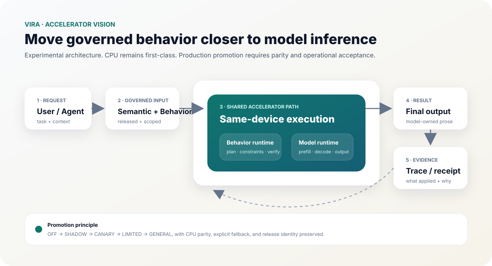

<h1 <p align="center"><strong>Vira</strong></p>
<h2 align="center">Behavior control for AI systems</h2
<p align="center">Connect AI systems once, author governed behavior, learn from evidence, evaluate changes and response quality, release explicit behavior, resolve it at runtime, and trace what happened.</p>

<p align="center">
  
  
  
  
  
</p>

<p align="center">
  <a href="#quickstart">Quickstart</a> ·
  <a href="docs/capability-map.md">Capabilities</a> ·
  <a href="docs/canonical-authoring.md">Authoring</a> ·
  <a href="docs/capability-discovery.md">Capability discovery</a> ·
  <a href="docs/teach.md">Teach AI</a> ·
  <a href="docs/decision-and-quality.md">Decision & Quality</a> ·
  <a href="docs/README.md">Docs</a>
</p>

<p align="center"></p>

---

## What Vira is

Vira is a behavior-control layer for AI systems. It separates **learning about behavior**, **authoring behavior**, **activating behavior**, and **runtime decisions**.

```text
connect
→ observe evidence
→ discover / resolve
→ author Task / Point / Program / Strategy
→ Teach AI proposes
→ review / evaluate
→ activate or release explicitly
→ runtime resolve / execute
→ optional response-quality decision
→ trace / outcome
→ learn again
```

A model may propose. A quality layer may score. A decision layer may select or abstain. None of those silently rewrite released behavior.

> **AI can propose. Released behavior remains explicit.**

---

## Current public client packages

| Surface | Package | Current published line | Install |
| --- | --- | ---: | --- |
| JavaScript / TypeScript SDK | `@tryvira/sdk` | `0.1.6` | `npm install @tryvira/sdk` |
| MCP server/client | `@tryvira/mcp` | `0.1.6` | `npx -y @tryvira/mcp` |
| Python SDK | `tryvira-sdk` | `0.1.6` | `python -m pip install tryvira-sdk` |

The client packages are MIT-licensed. The hosted Vira service and this public documentation repository are governed separately.

See [Published packages](docs/published-packages.md).

---

## First-class public capabilities

| Capability | What it does |
| --- | --- |
| **Connect once** | Register an AI system + adapter and receive system, connection, and handshake state. |
| **Capability discovery** | Discover which scoped capabilities are available on SDK, Python, MCP, API, or Studio surfaces. |
| **Semantic Task authoring** | List and create scoped Semantic Tasks. |
| **Behavior Point authoring** | List and create canonical Behavior Points bound to Tasks. |
| **Programs & Strategies** | Author bounded behavior, create variants, validate, simulate, and explicitly activate Strategy revisions. |
| **Teach AI** | Submit evidence, create proposals, then review, evaluate, and promote them without silently changing production behavior. |
| **Behavior Evaluation** | Test candidate behavior/artifacts before approval and release. |
| **Response Quality & Decision** | Evaluate bounded response candidates, select an eligible option, or abstain. |
| **Release & Runtime** | Make approved behavior eligible, then resolve/execute it at runtime. |
| **Trace & Outcome** | Preserve what was selected/applied and feed later evidence back into the lifecycle. |

See the full [Capability × Integration Surface matrix](docs/capability-map.md).

---

## Scoped capability discovery

Do not guess what a credential or surface can do. Query it.

```ts
const capabilities = await vira.listCapabilities({ surface: "sdk" });
```

```python
capabilities = client.list_capabilities(surface="python")
```

```text
GET /v1/capabilities?surface=api
```

MCP:

```text
list_capabilities
```

The result is scoped and can describe stable capability keys, required roles, supported surfaces, and whether an operation is effectful.

See [Capability discovery](docs/capability-discovery.md).

---

## Canonical authoring

Packs are no longer the only public authoring path. Core objects can also be authored directly through SDK, Python, HTTP, and MCP.

```text
Semantic Task
      ↓
Behavior Point
      ↓
Program / Strategy
      ↓
validate / simulate
      ↓
activate / evaluate / release as required
```

JavaScript:

```ts
const task = await vira.createSemanticTask({
  taskKey: "marketing.launch_plan",
  description: "Create a measurable launch plan",
  examples: ["Build a launch plan for a membership product"],
  negativeExamples: ["Write a single ad headline"],
});

const taskId = String(task?.body.task?.id ?? "");

await vira.createBehaviorPoint({
  key: "marketing.launch_plan",
  taskId,
  constraints: ["cover required funnel stages", "include measurement"],
});
```

Strategy activation is explicit:

```ts
await vira.validateBehaviorStrategy(strategyId);
await vira.activateBehaviorStrategy(strategyId);
```

Use direct authoring for incremental SDK/Studio/MCP workflows. Use Packs when several related objects should move together as one portable, reviewable bundle.

See [Canonical authoring](docs/canonical-authoring.md) and [Authoring quality](docs/authoring-quality.md).

---

## Teach AI has a public proposal lifecycle

```text
evidence
→ proposal
→ review
→ evaluate
→ promote
→ explicit release
→ runtime
→ outcome
→ new evidence
```

JavaScript/Python expose evidence + proposal lifecycle methods. MCP now exposes:

```text
submit_teach_evidence
create_teach_proposal
transition_teach_proposal
create_release
```

Promotion still does not silently grant release authority.

See [Teach AI](docs/teach.md).

---

## How Vira works

### Request → behavior → runtime


Semantic routing identifies the work. A Behavior Point is the stable governed attachment point. Programs and Strategies define behavior. Runtime resolves eligible behavior for the request.

### Strategy can own or guide the final answer

```text
response
Vira Strategy → final answer
```

```text
behavior_plan
Vira Strategy → compact behavior plan → downstream model → final answer
```

See [Strategy result modes](docs/strategy-result-modes.md).

### Response quality is a separate decision layer

```text
bounded candidates
→ quality evaluation
→ policy / eligibility
→ select OR abstain
```

This is not the same as Behavior Evaluation and it does not grant release authority. See [Decision & response quality](docs/decision-and-quality.md).

---

## Quickstart

### JavaScript / TypeScript

```bash
npm install @tryvira/sdk
```

```ts
import { ViraClient } from "@tryvira/sdk";

const vira = new ViraClient({
  baseUrl: process.env.VIRA_API_URL!,
  apiKey: process.env.VIRA_API_KEY,
});

const connected = await vira.connectOnce({
  name: "marketing-agent",
  systemType: "custom-agent",
  organizationId: process.env.VIRA_ORGANIZATION_ID!,
  projectId: process.env.VIRA_PROJECT_ID!,
  environmentId: process.env.VIRA_ENVIRONMENT_ID!,
  adapterType: "custom-node",
  adapterVersion: "1",
  idempotencyKey: "connect:marketing-agent:v1",
});

await vira.testConnection(String(connected?.body.connection?.id));
```

### Python

```bash
python -m pip install tryvira-sdk
```

```python
from vira import ViraClient

with ViraClient(VIRA_API_URL, api_key=VIRA_API_KEY) as client:
    connected = client.connect_once(
        "marketing-agent", "custom-agent", scope,
        "custom-python", "1",
        idempotency_key="connect:marketing-agent:v1",
    )
```

### MCP

```bash
npx -y @tryvira/mcp
```

After initialization, call `tools/list`. The current package exposes **41 tools**, including capability discovery, canonical authoring, Teach lifecycle, Strategy execution, Pack lifecycle, and behavior projection.

See [MCP setup](docs/reference/mcp.md) and the [MCP tool catalog](docs/reference/mcp-tools.md).

---

## Accelerator vision

> **Experimental architecture. Not general production availability.**



Vira is exploring a same-device path where released behavior execution can move closer to model inference while preserving parity, traceability, and explicit fallback. CPU/conventional runtime remains first-class.

Read [GPU acceleration vision](docs/gpu-acceleration-vision.md).

---

## Choose your path

| Goal | Start here |
| --- | --- |
| See the full public surface | [Capability map](docs/capability-map.md) |
| Discover what this credential can use | [Capability discovery](docs/capability-discovery.md) |
| Author Tasks / Points directly | [Canonical authoring](docs/canonical-authoring.md) |
| Learn authoring quality | [Authoring quality](docs/authoring-quality.md) |
| Understand Teach AI | [Teach AI](docs/teach.md) |
| Understand response quality | [Decision & response quality](docs/decision-and-quality.md) |
| Integrate JS/Python/MCP/HTTP | [Docs map](docs/README.md) |
| Debug an integration | [Troubleshooting](docs/troubleshooting/README.md) |
| Use AI to author/install/debug Vira | [AI Prompt Library](docs/ai-prompts/README.md) |
| Follow an end-to-end example | [Marketing Agent tutorial](tutorials/marketing-agent/README.md) |

---

## Security and license

Never put API keys, MCP tokens, personal data, confidential information, or production traces in public issues or examples.

The documentation/examples in this repository are proprietary. The separately published client packages listed above are MIT-licensed according to their package metadata. See [LICENSE](LICENSE), [SECURITY.md](SECURITY.md), and [SUPPORT.md](SUPPORT.md).
