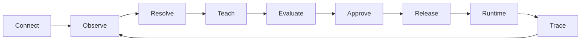

# Vira

**Behavior control for AI systems.**

Vira helps teams turn repeated AI corrections into **reviewable, testable, releasable behavior**.

Instead of hiding important behavior inside longer prompts, scattered rules, or one-off fixes, Vira gives AI systems a lifecycle for observing what happened, discovering what behavior applies, proposing improvements, evaluating them, releasing approved behavior, and tracing what was applied.

> **Stop re-teaching the same behavior in every conversation.**

## The Vira loop



The important separation is simple:

**AI can propose. Released behavior remains explicit.**

A model suggestion does not become production behavior just because a model produced it.

## A simple example

A user asks a marketing assistant:

> Create a go-to-market plan for a new subscription product.

The assistant produces a useful answer but repeatedly misses retention and measurement.

The user corrects it:

> For launch plans, cover the full funnel and define how each stage will be measured.

Without a behavior layer, that correction can disappear into another prompt edit or another conversation.

With Vira, the correction can become evidence for a reviewable behavior change, be evaluated, approved, released, and resolved for future relevant requests.

The next user should not have to repeat the same lesson.

## What Vira gives you

| Problem | Vira |
| --- | --- |
| The same correction keeps returning | Turn repeated feedback into governed behavior |
| Prompts become a pile of hidden rules | Separate behavior from ad-hoc prompt editing |
| Different agents drift | Resolve behavior in explicit scope |
| Learning silently changes production | Keep proposals separate from released behavior |
| Task routing guesses too confidently | Allow explicit select, uncertainty, or no-match outcomes |
| Nobody knows why the AI behaved that way | Show a simple runtime trace |
| Model changes force behavior rewrites | Keep the behavior layer separate from one model provider |

## Start here

If you want to understand the product:

1. [What is Vira?](docs/what-is-vira.md)
2. [Core concepts](docs/core-concepts.md)
3. [How Vira works](docs/how-vira-works.md)

If you want to build with it:

1. [Authentication and scope](docs/auth-and-scope.md)
2. [JavaScript / TypeScript SDK](docs/sdk/javascript.md)
3. [Python SDK](docs/sdk/python.md)
4. [Behavior Points](docs/behavior-points.md)
5. [Signals](docs/signals.md)
6. [Semantic routing](docs/semantic-routing.md)
7. [Behavior Programs](docs/behavior-programs.md)
8. [Strategies](docs/strategies.md)
9. [Teach](docs/teach.md)
10. [Evaluation and approval](docs/evaluation-and-approval.md)
11. [Release](docs/release.md)
12. [Runtime](docs/runtime.md)
13. [Simple traces](docs/traces.md)
14. [Public API reference](docs/api-reference.md)

Or follow the complete [Marketing Agent tutorial](tutorials/marketing-agent/README.md).

## SDKs and MCP

### JavaScript / TypeScript

```bash
npm install @vira/sdk
```

```ts
import { ViraClient } from "@vira/sdk";

const vira = new ViraClient({
  baseUrl: process.env.VIRA_API_URL!,
  apiKey: process.env.VIRA_API_KEY,
});
```

### Python

```bash
python -m pip install vira-sdk
```

```python
from vira import ViraClient
```

### MCP

```bash
npx -y @vira/mcp
```

Read [docs/mcp.md](docs/mcp.md).

## Behavior Points

A **Behavior Point** is a named place in an AI workflow where governed behavior can apply.

Examples:

```text
marketing.launch_plan
support.refund_request
research.source_claim
```

The supported public authoring pattern is through a Vira Pack. Installing a Pack materializes the semantic task, Behavior Point, behavior program, strategy, policy, and revision inside the normal lifecycle. Importing a Pack alone does not activate behavior.

Read [docs/behavior-points.md](docs/behavior-points.md).

## Signals

Signals are typed pieces of evidence used by behavior logic and discovery.

Examples:

```text
feedback.user_correction
quality.missing_measurement
risk.requires_review
outcome.accepted
```

Public integrations normally produce evidence through observations, feedback, outcomes, and supported discovery workflows. Direct private signal internals are not part of this repository.

Read [docs/signals.md](docs/signals.md).

## Semantic routing

Vira can resolve a request to an eligible governed task without treating classification as authority.

```ts
const semantic = await vira.resolveSemantic({
  input: "Build a launch plan for a new membership product",
  profile: { domain: "marketing" },
});
```

A semantic result can select, abstain, or fail to match. It is not authorization.

Read [docs/semantic-routing.md](docs/semantic-routing.md).

## Strategies

A Behavior Strategy describes a bounded multi-step execution approach for a Behavior Point.

Strategies can contain model, tool, branch, verification, composition, user-input, decision, and transform steps.

They do not replace hard policy authority.

Read [docs/strategies.md](docs/strategies.md).

## Teach

Teach turns admitted evidence into a reviewable proposal.

The basic lifecycle is:

```text
evidence
→ proposal
→ review
→ evaluation
→ promotion
→ release path
```

Teach does not silently rewrite production behavior.

Read [docs/teach.md](docs/teach.md).

## Runtime and traces

Runtime resolution uses released behavior.

A public trace should answer only the questions a developer needs:

```text
Task            marketing.launch_plan
Behavior Point  marketing.launch_plan
Behavior        full_funnel_launch_planning
Applied         yes
Result          completed
```

This public repository intentionally does not expose internal receipt payloads, authority digests, private release metadata, or commercial logic.

Read [docs/runtime.md](docs/runtime.md) and [docs/traces.md](docs/traces.md).

## Repository scope

This repository is Vira's public **product and developer hub**.

It includes:

- public product documentation;
- SDK guides;
- MCP guidance;
- public API reference;
- public-safe examples;
- tutorials;
- Pack authoring examples;
- public-safe behavior, signal, Teach, Strategy, evaluation, release, and runtime guidance.

It does not include:

- private Vira server source;
- customer configuration;
- private prompts;
- proprietary scoring or thresholds;
- private authority algorithms;
- production credentials;
- internal infrastructure topology;
- raw internal receipts;
- unreleased product mechanisms.

See [docs/repository-scope.md](docs/repository-scope.md).

## Security

Do not post credentials, customer data, private prompts, or production traces into public issues.

Read [SECURITY.md](SECURITY.md).

## Contributing

Read [CONTRIBUTING.md](CONTRIBUTING.md) and [CODE_OF_CONDUCT.md](CODE_OF_CONDUCT.md).

## License

The contents of this public repository are licensed under the [Apache License 2.0](LICENSE), unless a file states otherwise.

This repository license does not imply that private Vira services or proprietary server-side implementation are open source.
