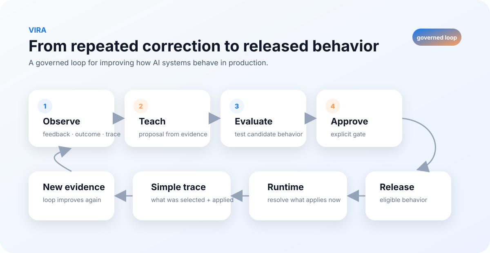
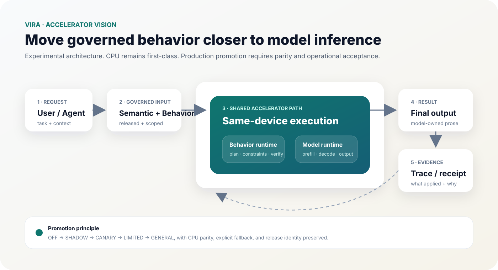

<h1 align="center">Vira</h1>
<h2 align="center">Behavior control for AI systems</h2>
<p align="center">Connect AI systems once, author governed behavior, learn from evidence, evaluate changes, release explicit behavior, resolve it at runtime, and trace what happened.</p>

<p align="center">
  
  
  
  
  
</p>

<p align="center">
  <a href="#quickstart">Quickstart</a> ·
  <a href="docs/developer-guide.md">Developer guide</a> ·
  <a href="docs/capability-map.md">Capabilities</a> ·
  <a href="docs/canonical-authoring.md">Canonical authoring</a> ·
  <a href="docs/packs.md">Packs</a> ·
  <a href="docs/README.md">Docs</a>
</p>

<p align="center"></p>

---

## What Vira is

Vira is a behavior-control layer for AI systems. It separates learning about behavior, authoring behavior, activation/release authority, and runtime enforcement.

```text
connect
→ observe evidence
→ discover / semantic resolve
→ author Task / Point / Program / Strategy
→ Teach AI can propose
→ review / evaluate
→ activate and/or release explicitly
→ runtime resolve / execute
→ receipt / trace / outcome
→ learn again
```

The important boundary is simple:

> **AI can propose. Semantic routing can select. Quality can score. Released behavior remains explicit.**

A semantic match is not authorization. A Teach promotion is not a hidden release. Pack import/install is not activation. Strategy activation does not bypass scope, policy, evaluation, release, or runtime checks.

---

## Public client packages

| Surface | Package | Current line | Runtime | Install |
| --- | --- | ---: | --- | --- |
| JavaScript / TypeScript SDK | `@tryvira/sdk` | `0.1.14` | Node.js 20+ | `npm install @tryvira/sdk` |
| MCP server/client | `@tryvira/mcp` | `0.1.14` | Node.js 20+ | `npx -y @tryvira/mcp` |
| Python SDK | `tryvira-sdk` | `0.1.14` | Python 3.10+ | `python -m pip install tryvira-sdk` |

The public client packages are MIT-licensed. The hosted Vira service, backend, branding, and this documentation repository are governed separately.

See [Published packages](docs/published-packages.md).

---

## Quickstart

### JavaScript / TypeScript

```bash
npm install @tryvira/sdk
```

```ts
import { ViraClient } from "@tryvira/sdk";

const vira = new ViraClient({
  baseUrl: process.env.VIRA_CONTROL_URL ?? process.env.VIRA_API_URL!,
  apiKey: process.env.VIRA_API_KEY,
});

const connected = await vira.connectOnce({
  name: "example-agent",
  systemType: "custom-agent",
  organizationId: process.env.VIRA_ORGANIZATION_ID!,
  projectId: process.env.VIRA_PROJECT_ID!,
  environmentId: process.env.VIRA_ENVIRONMENT_ID!,
  adapterType: "custom-node",
  adapterVersion: "1",
  idempotencyKey: "connect:example-agent:v1",
});

const capabilities = await vira.listCapabilities({ surface: "sdk" });
```

Use environment variables and placeholder values in checked-in examples. Never commit real credentials or private tenant/service information.

### Python

```bash
python -m pip install tryvira-sdk
```

```python
from vira import ViraClient

with ViraClient(VIRA_API_URL, api_key=VIRA_API_KEY) as client:
    capabilities = client.list_capabilities(surface="python")
```

### MCP

```bash
npx -y @tryvira/mcp
```

MCP clients should discover the live surface instead of hard-coding a tool count:

```text
server/discover
→ initialize
→ tools/list
→ tools/call
```

Effectful MCP tools remain governed by Vira's authority boundary.

---

## Canonical authoring

Vira supports direct authoring through SDK, Python, HTTP, and MCP.

```text
Semantic Task
      ↓
Behavior Point
      ↓
Program / Strategy
      ↓
validate / simulate
      ↓
evaluate / activate / release as required
      ↓
runtime
```

JavaScript example:

```ts
const task = await vira.createSemanticTask({
  taskKey: "marketing.launch_plan",
  description: "Create a measurable launch plan",
  examples: ["Build a launch plan for a membership product"],
  negativeExamples: ["Write a single ad headline"],
});

const taskId = String(task?.body.task?.id ?? "");

await vira.createBehaviorPoint({
  key: "marketing.launch_plan",
  taskId,
  constraints: [
    "cover the required funnel stages",
    "include a measurement approach"
  ],
});
```

Strategy activation is explicit:

```ts
await vira.validateBehaviorStrategy(strategyId);
await vira.simulateBehaviorStrategy(strategyId, {});
await vira.activateBehaviorStrategy(strategyId);
```

See [Canonical authoring](docs/canonical-authoring.md), [Behavior Points](docs/behavior-points.md), [Behavior Programs](docs/behavior-programs.md), and [Strategies](docs/strategies.md).

---

## Semantic resolution and runtime are different

```ts
const semantic = await vira.resolveSemantic({
  input: "Build a launch plan",
  profile: { domain: "marketing" },
});
```

Semantic resolution returns candidate/evidence information. It does not grant authority.

```ts
const runtime = await vira.resolveRuntime({
  behaviorPoint: "marketing.launch_plan",
  executionBoundary: {
    organizationId: process.env.VIRA_ORGANIZATION_ID!,
    projectId: process.env.VIRA_PROJECT_ID!,
    environmentId: process.env.VIRA_ENVIRONMENT_ID!,
  },
  idempotencyKey: "runtime:launch-plan:001",
});
```

Runtime is the enforcing boundary and can deny, abstain, or require an eligible released identity.

---

## Teach AI, Evaluation, Release

Teach AI turns admitted evidence into governed proposals:

```text
evidence
→ proposal
→ review
→ evaluate
→ promote
→ explicit release
→ runtime
→ outcome
```

Public client methods include `createTeachProposal`, `transitionTeachProposal`, Behavior Evaluation methods, and governed release methods. Promotion remains separate from release authority.

See [Teach AI](docs/teach.md), [Evaluation and approval](docs/evaluation-and-approval.md), and [Release](docs/release.md).

---

## Packs

Use Packs when related Tasks, Points, Programs, Strategies, policies/signals, and evaluation material should move together.

```text
import
→ parse / validate
→ inventory / conflicts
→ configure
→ install / materialize draft
→ evaluate
→ approve
→ release
→ runtime
```

Import never activates behavior. Installation materializes canonical draft objects; evaluation, approval, and release remain separate.

Public client methods include:

```text
listPacks
importPack
installPack
evaluatePack
approvePack
releasePack
previewPackUpgrade
```

There is intentionally no client-side `verifyPack()` shortcut that can declare a candidate production-safe. Pack verification is the governed lifecycle above plus runtime receipt/trace inspection.

See [Packs](docs/packs.md) and the [Developer guide](docs/developer-guide.md).

---

## Response Quality & Decision

Response Quality & Decision evaluates bounded response candidates and can select or abstain. It is separate from Behavior Evaluation and it does not grant release authority.

See [Decision & response quality](docs/decision-and-quality.md).

---

## Capability discovery

Do not guess what a credential or integration surface can do.

```ts
const capabilities = await vira.listCapabilities({ surface: "sdk" });
```

```python
capabilities = client.list_capabilities(surface="python")
```

```text
GET /v1/capabilities?surface=api
```

MCP uses `list_capabilities` plus `tools/list`.

See [Capability discovery](docs/capability-discovery.md) and the full [Capability map](docs/capability-map.md).

---

## Full developer path

The [Developer guide](docs/developer-guide.md) walks through the public lifecycle end to end:

```text
install client
→ connect
→ discover capabilities
→ observe
→ create Semantic Task
→ create Behavior Point
→ Program / Strategy
→ semantic resolve
→ evaluate / release
→ runtime resolve
→ Strategy continuation
→ Pack import / materialize / verify / release
→ receipts / traces
```

Copyable examples:

- [`examples/javascript/end-to-end-lifecycle.mjs`](examples/javascript/end-to-end-lifecycle.mjs)
- [`examples/javascript/canonical-authoring.mjs`](examples/javascript/canonical-authoring.mjs)
- [`examples/packs/marketing-starter/`](examples/packs/marketing-starter/)
- [`examples/authoring-quality/`](examples/authoring-quality/)
- [`examples/python/`](examples/python/)
- [`examples/mcp/`](examples/mcp/)

---

## Advanced runtime surfaces

The current public SDK/API contract also includes Strategy execution, runtime capability attestation/resolution, model-serving decisions/traces, behavior capsule/projection, Pack upgrade preview, and deployment evidence.

See [JavaScript SDK reference](docs/reference/javascript-sdk.md), [Python SDK reference](docs/reference/python-sdk.md), [MCP integration](docs/reference/mcp.md), and [HTTP API reference](docs/reference/api.md).

---

## Accelerator vision

> **Experimental architecture. Not general production availability.**



Vira is exploring a same-device path where released behavior execution can move closer to model inference while preserving parity, traceability, and explicit fallback. CPU/conventional runtime remains first-class.

Read [GPU acceleration vision](docs/gpu-acceleration-vision.md).

---

## Security and license

Never put API keys, MCP tokens, tenant identifiers, personal/customer data, private infrastructure URLs, production traces, or internal operator configuration in public issues or examples.

The documentation/examples in this repository are proprietary. The separately published client packages listed above are MIT-licensed according to their package metadata. See [LICENSE](LICENSE), [SECURITY.md](SECURITY.md), and [SUPPORT.md](SUPPORT.md).
