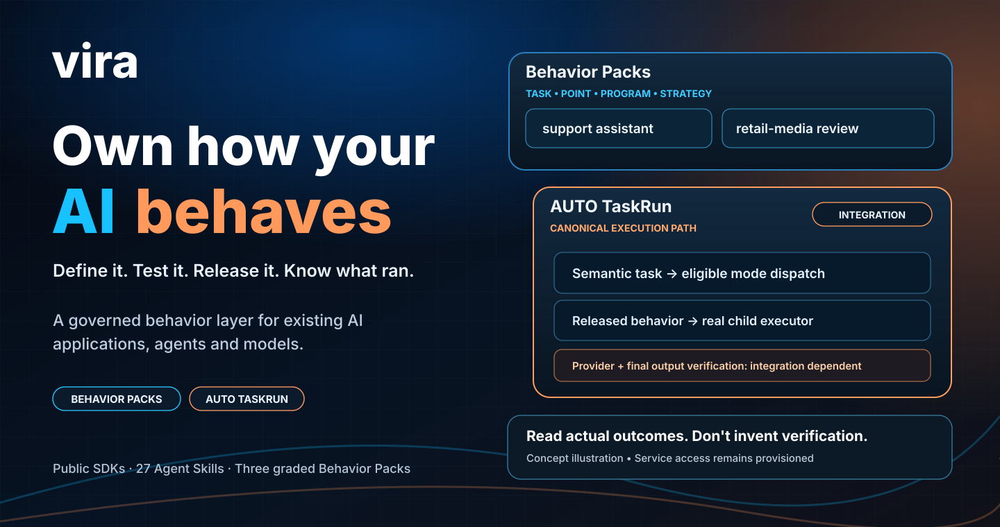
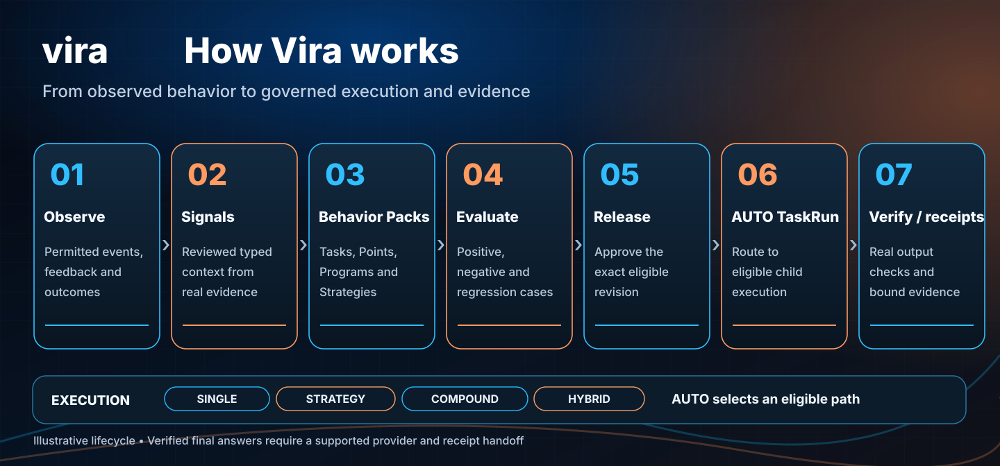
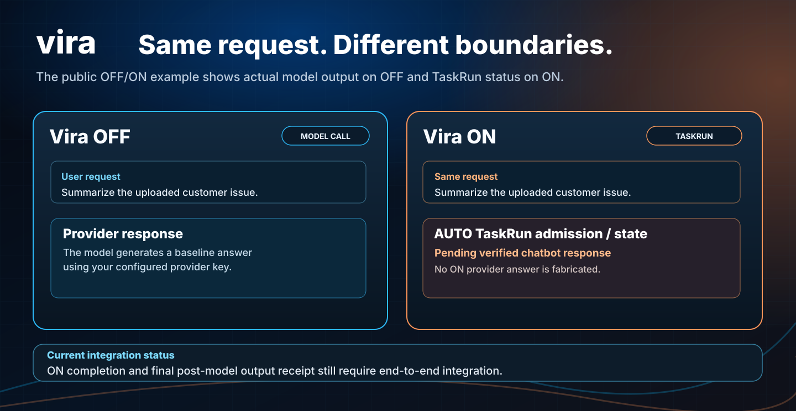
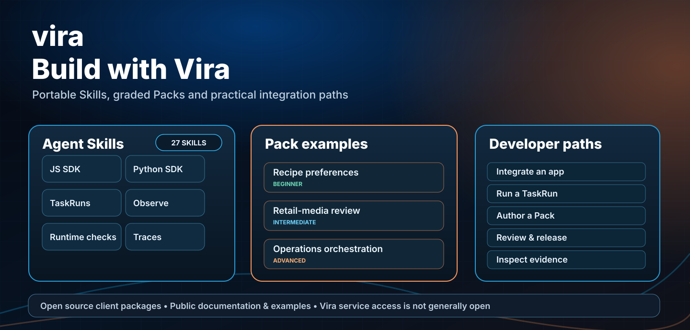

**Yapay zekânın nasıl yanıt verdiğini, karar verdiğini ve araç kullandığını tanımlayın, test edin ve yönetin.**

Vira; mevcut AI uygulamalarının ve agent'ların davranışlarını modelden ve tek bir uzun prompt'tan bağımsız, yönetilebilir bir katmanda ele almak için geliştiriliyor. Göreve özgü gereksinimleri tanımlamayı, değişiklikleri değerlendirmeyi, sürümlemeyi, yetkili biçimde yayımlamayı ve çalışma anında neyin uygulandığını incelemeyi hedefliyor.

**Geliştirme aşamasında:** SDK ve örnekler herkese açık. Ancak Vira hizmetine ve Studio iş akışlarına genel erişim henüz açık değil. Ürün erişimi olmadan chatbot örneğinin **Vira OFF** tarafını, kendi model sağlayıcı anahtarınızla çalıştırabilirsiniz. **Vira ON** için Vira hesabı, yetkili bağlantı ve yayımlanmış uygun davranış gerekiyor.

## Neden Vira?

Bir asistanın verdiği yanlış cevabı düzeltmek kolay. Aynı düzeltmenin farklı modellerde, agent'larda ve sürümlerde **hangi kapsamda geçerli olduğunu**, **test edilip edilmediğini** ve **gerçekte uygulanıp uygulanmadığını** yönetmek zor.

Vira davranışı bir prompt parçası olmaktan çıkarıp gözden geçirilebilen ve sürümlenebilen bir ürün bileşeni hâline getirmeyi amaçlıyor:

- **Tanımla:** Semantic Task, Behavior Point, Behavior Program ve Strategy.
- **Değerlendir:** Örnekler, karşı örnekler, inceleme ve onay kapıları.
- **Yayımla:** Yetkili ve kapsamı belirlenmiş sürümü ayrı bir kararla etkinleştir.
- **Uygula ve izle:** Entegrasyonun desteklediği runtime kimliği, yanıt ve trace bilgilerini incele.
- **İyileştir:** İzinli gerçek kullanım verilerinden Teach önerileri oluştur; değerlendirme olmadan otomatik canlıya geçirme.

**Örnek:** Bir retail-media asistanı iki kampanyanın ROAS değerini karşılaştırırken farklı attribution window veya satış kapsamlarını aynı kabul etmemeli. Vira'da bu kontrol, göreve ait açık bir davranış olarak tanımlanıp değerlendirilebilir. Bu bir ürün senaryosudur; kanıtlanmış bir performans artışı iddiası değildir.

## Gözlemle, tanımla, uygula, doğrula, iyileştir

*Bu görsel mimariyi anlatır; canlı son model yanıtının doğrulandığına dair kanıt değildir.*

Vira yalnızca Pack yükleme veya prompt yönetimi değildir. Mevcut AI sisteminden **Observe** ile izinli kullanım kanıtı toplar; **Signal** ile bu kanıtlara tanımlı ve onaylı anlam kazandırmayı hedefler; **Teach** ile iyileştirme önerisi üretir. **Evaluation** ve ayrı **approval/release** kararından sonra uygun davranış **AUTO TaskRun** akışında çalışır. **Runtime verification** sonuçta hangi kontrollerin gerçekten geçip kalmadığını belirler; **receipt/trace** bunları araştırılabilir hâle getirir.

| İhtiyaç | Rehber |
| --- | --- |
| Agent'ın olaylarını, araç çağrılarını, hatalarını ve sonuçlarını izlemek | [Observe](docs/observe.md) |
| Versiyonlu Signal, kaynak eşlemesi, onay ve runtime attestation | [Signals](docs/signals.md) |
| Düzeltme/geri bildirimden denetimli davranış iyileştirmeye gitmek | [Teach](docs/teach.md) |
| Gerçek yanıtı post-model kontrol ve gerektiğinde repair/block ile doğrulamak | [Runtime verification](docs/runtime-verification.md) |
| Bütün özellik aileleri, veri/güvenlik, Studio/Admin, optimizasyon ve sınırlamalar | [Tam ürün haritası](docs/product-feature-map.md) · [Durum tablosu](docs/product-status.md) |

**Observe olayının kabul edilmesi doğrulama başarısı değildir; Signal otomatik olarak güvenilir kural hâline gelmez; TaskRun'ın tamamlanması da doğrulanmış son chatbot yanıtını tek başına kanıtlamaz.**

## Tek canonical çalışma yolu

**AUTO TaskRun → semantic resolve → mod seçimi → gerçek child executor → runtime enforcement → provider/chatbot → post-model verification/receipt.** Kullanıcı her istekte SINGLE/STRATEGY/COMPOUND/HYBRID seçmez. `behavior-projection` yalnızca ileri seviye SDK/diagnostic kullanımda kalır. Public API henüz doğrulanmış son chatbot yanıtının tamamını kanıtlamadığından ON örneği sahte yanıt üretmez.

[Teknik akış (EN)](docs/canonical-taskrun.md) · [Marka konumlandırması (EN)](docs/brand-positioning.md) · [Üç ayrıntılı Pack (EN)](examples/packs/README.md) · [Pack alanları nasıl doldurulur? (EN)](docs/pack-authoring-guide.md)

## Tek örnek değil, farklı seviyelerde kullanım

| Seviye | Örnek | Davranış gereksinimi |
| --- | --- | --- |
| Günlük | Dört kişilik yemek tarifi | Vejetaryen ve soğansız tercihleri korumak |
| Temel iş | Müşteri desteği | Bilinmeyen kargo durumunu uydurmamak |
| Analitik | Reklam kampanyası karşılaştırması | Farklı attribution pencerelerini eşdeğer saymamak |
| İleri | Olay analizi | Aşamaları ve doğrulamayı ayrı yönetmek |
| Çoklu görev | Operasyon raporu | Birden fazla yetkili görevi doğru birleştirmek |

[Tam örnek kataloğu (EN)](docs/use-cases.md) · [Skills, agent ve diğer platformlarla tarafsız kıyaslama (EN)](docs/approach-comparison.md)

### Çalıştırma modları

**SINGLE:** tek görev. **STRATEGY:** tek görevde birden fazla aşama. **COMPOUND:** birden çok farklı görev. **HYBRID:** SINGLE ve STRATEGY alt görevleri. **AUTO:** uygun modun önerilmesini ister, ayrı bir çalıştırma modu değildir. Görev ve sürüm uygun değilse otomatik bir başarı sonucu üretilmez.

[Beş seçeneğin teknik açıklaması (EN)](docs/execution-modes.md)

## Başlayın

| Amacınız | Bağlantı |
| --- | --- |
| Ne işe yaradığını öğrenmek | [Ürün anlatımı (EN)](docs/what-is-vira.md) |
| Yerel OFF/ON chatbot örneğini denemek | [Next.js örneği (EN)](examples/frameworks/node-next/README.md) |
| JavaScript, Python veya MCP ile bağlanmak | [Geliştirici rehberi (EN)](docs/developer-guide.md) |
| Davranış paketi / Teach sürecini anlamak | [Packs](docs/packs.md) · [Teach](docs/teach.md) |
| Agent Skills kullanmak | [Skills](skills/README.md) |
| Müşteri olarak değerlendirmek | [Ekipler için rehber (EN)](docs/for-teams.md) |

**Lisans ayrımı:** Bu herkese açık dokümantasyon deposunun lisansı proprietary'dir. Ayrı dağıtılan SDK/MCP paketleri kendi MIT lisanslarına tabidir. [Ayrıntılar](docs/published-packages.md).

[English README](README.md) · [Dokümantasyon](docs/README.md) · [Sorun bildir](https://github.com/hrpering/tryvira/issues)
