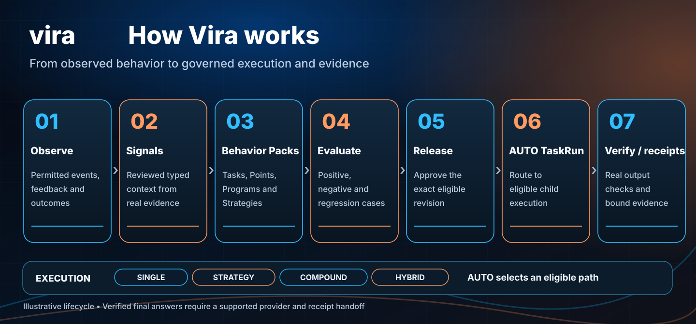

# Vira documentation

Learn how Vira helps you define, test, release and inspect the behavior of an existing AI application or agent.

**New here?** Start with [What is Vira?](what-is-vira.md) or [try the public examples](../examples/README.md). The SDKs and Agent Skills are public; live Vira operations require access to a provisioned environment.

## Choose your path

| Your goal | Start here |
| --- | --- |
| Understand the product and its use cases | [Overview](what-is-vira.md) · [Practical scenarios](use-cases.md) |
| Try the chatbot or an integration example | [Quickstart](start-here.md) · [Next.js chatbot](../examples/frameworks/node-next/README.md) |
| Add Vira to an existing JavaScript or Python application | [Developer guide](developer-guide.md) · [Integration patterns](integration-patterns.md) |
| Work with an AI coding agent | [27 Agent Skills](../skills/README.md) |
| Evaluate Vira for a team | [Team guide](for-teams.md) · [Product capabilities](product-feature-map.md) |
| Diagnose an integration | [Troubleshooting](troubleshooting/README.md) |

## Work with AI behavior

Vira separates *what should happen* from *how an application runs*. You can explore each part independently:

| Workflow | Learn | Try |
| --- | --- | --- |
| Connect and observe an AI application | [Observe](observe.md) · [Signals](signals.md) | [JavaScript and Python examples](../examples/README.md) |
| Define a reusable behavior | [Behavior Points](behavior-points.md) · [Programs](behavior-programs.md) | [Pack Academy](../examples/packs/README.md) |
| Evaluate and release a revision | [Evaluation](evaluation-and-approval.md) · [Release](release.md) | [Marketing Agent tutorial](../tutorials/marketing-agent/README.md) |
| Execute eligible work | [AUTO TaskRun](canonical-taskrun.md) · [Execution modes](execution-modes.md) | [TaskRun routing example](../examples/javascript/taskrun-modes.mjs) |
| Verify and improve | [Runtime verification](runtime-verification.md) · [Teach](teach.md) | [Traces and receipts](traces.md) |

## Developer reference

- [JavaScript SDK](reference/javascript-sdk.md) · [Python SDK](reference/python-sdk.md) · [MCP](reference/mcp.md) · [HTTP API](reference/api.md)
- [Client capability compatibility](capability-map.md) · [Published packages](published-packages.md) · [Product availability](product-status.md)
- [Core concepts](core-concepts.md) · [Architecture](architecture.md) · [Authoring guide](pack-authoring-guide.md)
- [Behavior strategy guide](strategies.md) · [Semantic routing](semantic-routing.md) · [Security and scope](auth-and-scope.md)
- [Example verification](example-verification.md) · [Verified-answer integration requirements](verified-answer-handoff.md) · [FAQ](faq.md)

**Integration note:** Available operations differ by SDK, MCP server, hosted environment and credentials. The public Next.js ON example currently shows AUTO TaskRun status, not a final provider answer verified by Vira. See [current availability](product-status.md).

## Help and contributing

[Contributing](../CONTRIBUTING.md) · [Support](../SUPPORT.md) · [Security reporting](../SECURITY.md) · [Repository license](../LICENSE)
