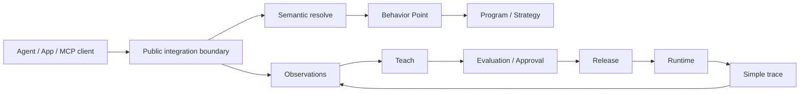

# Public architecture

## Public boundary

This diagram intentionally describes product concepts rather than private service topology.

It does not expose:

- private infrastructure;
- customer data;
- internal prompts;
- scoring formulas;
- authority digests;
- raw receipt formats;
- secret material.
