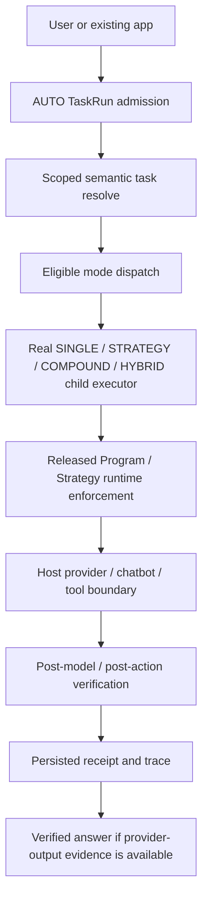
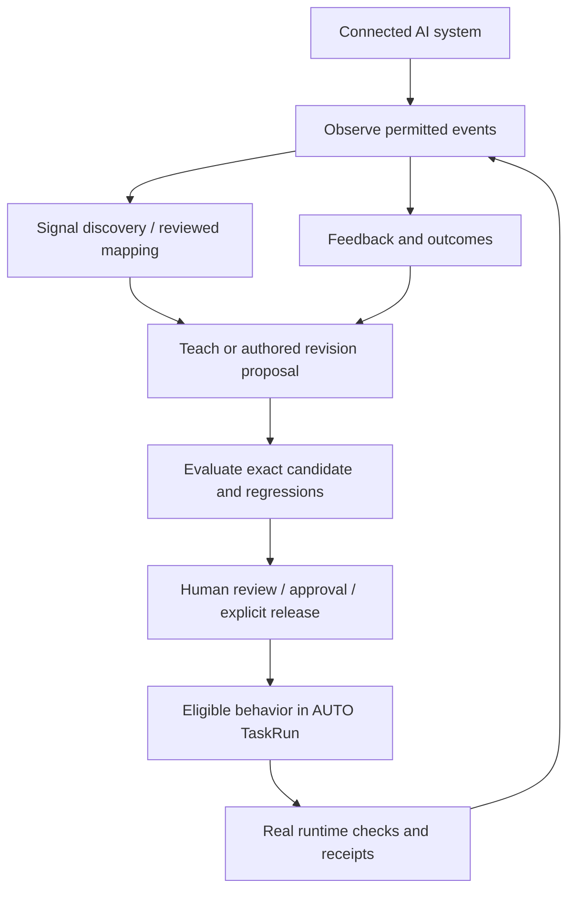

# Vira architecture: one runtime path, one governed improvement loop

The ordinary application request enters **AUTO TaskRun**, not a direct behavior-projection endpoint. Observations, feedback and Signals inform the separate **improvement** process without granting release authority.

## Execution path (canonical target)

The server owns scope, artifact identities and eligibility. Host capabilities determine which pre-model, pre-tool, post-model or pre-action boundary can be enforced. The normal user does not supply a private execution mode, select the Program or invent host permission.

**Current limitation:** real TaskRun child receipts alone are not a complete public verified-provider-answer readback. See [verified answer handoff](verified-answer-handoff.md) and [product status](product-status.md).

## Learning and operational evidence loop

An event is not a Signal. A Signal is not a release. A Teach proposal is not a production change. A TaskRun completed status is not a verified final chatbot response.

## Other platform boundaries

- **Studio** is the customer author/review/test/release workspace when available.
- **Admin** handles privileged operational controls, health, security, audit, release and incidents.
- **SDKs, MCP, HTTP and framework adapters** have different supported method surfaces.
- **Security** handles tenant/scope/actor, consent, secret and external-effect authorization.
- **Operations** covers workers, retries, traces, quotas, billing and provider status.
- **Experimental infrastructure** may include GPU/model serving and acceleration, but it must not be represented as a universal production feature without deployment-specific acceptance.

[Full feature inventory](product-feature-map.md) · [Observe](observe.md) · [Signals](signals.md) · [Runtime verification](runtime-verification.md) · [Developer guide](developer-guide.md)
