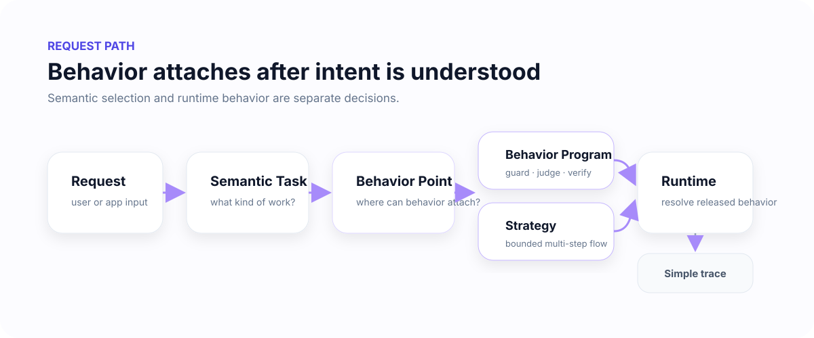
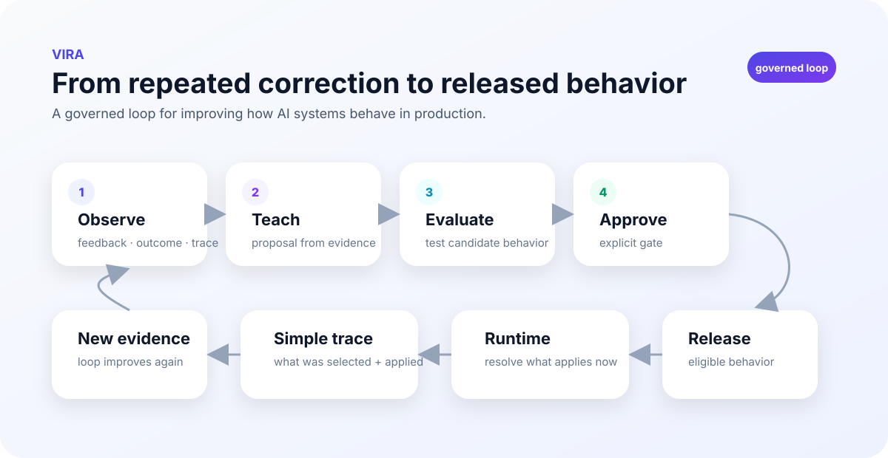
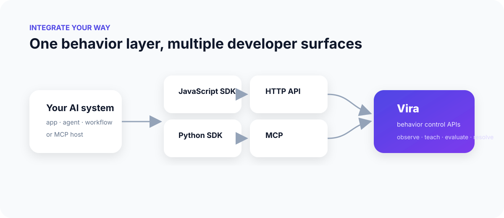

# How Vira works

Vira has two connected flows: a **request path** that decides what behavior can apply now, and an **improvement path** that turns evidence into a reviewed and releasable behavior change.

## 1. Request path



### Request

An application, agent, or MCP host sends work through a supported integration surface.

### Semantic Task

Semantic resolution identifies what kind of work the request represents. It can select a task, return uncertainty, or return no match.

This classification step does not activate behavior by itself.

### Behavior Point

A Behavior Point is the stable governed attachment point for behavior.

It answers a different question from semantic routing:

```text
Semantic Task  → what kind of work is this?
Behavior Point → where can governed behavior attach?
```

### Behavior Program or Strategy

A Behavior Program can express guards, judgments, transforms, verification, escalation, rubrics, examples, and anti-patterns.

A Strategy can express a bounded multi-step flow for tasks that require more than one operation.

### Runtime

Runtime resolves released behavior that is eligible for the current request and execution boundary.

### Trace

The developer-facing trace stays compact. It should explain the task, Behavior Point, applied behavior, and result without exposing unnecessary runtime internals.

---

## 2. Improvement path



### Observe

Applications can submit supported observations, feedback, and outcomes.

Observation is evidence. It is not a production change.

### Discover / Teach

Evidence can support Signal discovery, mapping, or a Teach proposal.

AI assistance can help identify patterns or propose candidate behavior, but that candidate still moves through explicit gates.

### Evaluate

Evaluation checks whether the candidate satisfies the required assertions and quality conditions.

### Approve

Approval is a separate lifecycle transition where required. Evaluation success and approval are not treated as the same thing.

### Release

Release makes the approved behavior eligible for runtime. Importing, installing, or proposing behavior does not equal release.

### Runtime → new evidence

Once released behavior is used, new observations and outcomes can feed the next improvement cycle.

---

## 3. Integration surfaces



Vira can be integrated through:

- JavaScript / TypeScript SDK;
- Python SDK;
- direct HTTP API;
- MCP.

These are different integration surfaces around the same behavior-control model.

## 4. A concrete example

Imagine a marketing agent receives:

```text
Build a launch plan for a membership product.
```

A simplified Vira path can look like:

```text
Semantic Task   marketing.launch_plan
Behavior Point  marketing.launch_plan
Behavior        full_funnel_launch_planning
Evaluation      funnel stages + measurement checks
Release         approved revision
Runtime         behavior resolved for this request
Trace           applied=yes, result=completed
```

If users repeatedly correct the agent because it forgets retention or measurement, those corrections can become evidence for a reviewed behavior improvement instead of another ad hoc prompt patch.

## 5. Where to go next

| Goal | Guide |
| --- | --- |
| Connect an application or agent | [Connect an AI system](guides/connect-an-ai-system.md) |
| Understand attachment points | [Behavior Points](behavior-points.md) |
| Understand evidence | [Signals](signals.md) |
| Build behavior | [Behavior Programs](behavior-programs.md) |
| Build multi-step behavior | [Strategies](strategies.md) |
| Learn from evidence | [Teach](teach.md) |
| Test candidates | [Evaluation and approval](evaluation-and-approval.md) |
| Make behavior eligible | [Release](release.md) |
| Resolve behavior | [Runtime](runtime.md) |
| Debug failures | [Troubleshooting](troubleshooting/README.md) |
