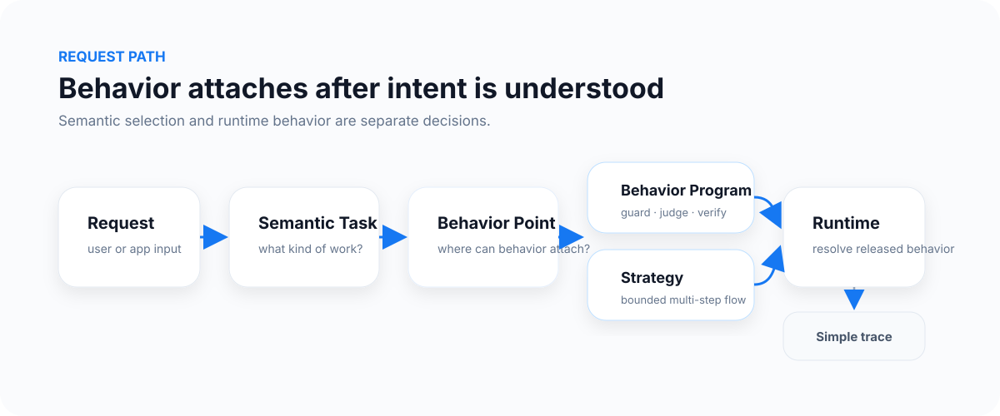
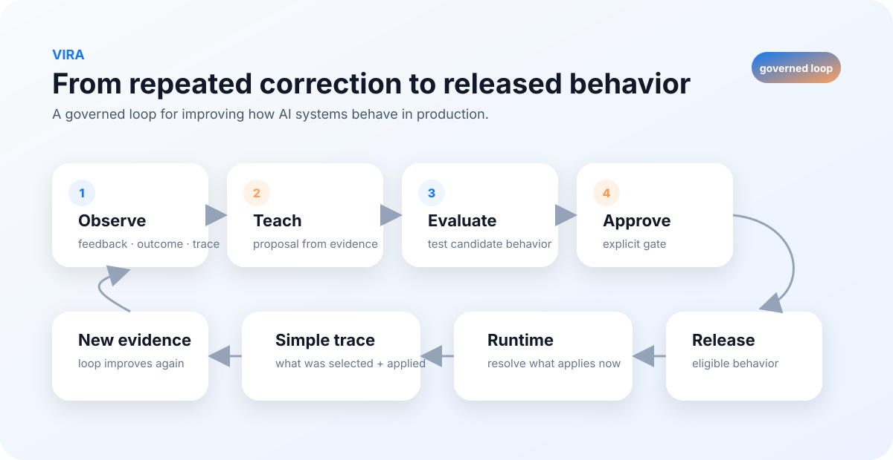

# Vira overview

Vira is under active development. Its public vision is to help teams make AI
behavior easier to define, review, and improve.

The product connects to an AI system, supports teams as they describe intended
behavior, and provides ways to review changes before using them. Integrations and
available operations depend on the published SDK/API version and account access.

The diagram is a product-level overview. It does not describe private service
architecture or implementation details. For developer setup, use the
[SDK references](reference/javascript-sdk.md), [Python reference](reference/python-sdk.md),
[HTTP API reference](reference/api.md), and current [MCP tool catalog](reference/mcp-tools.md).
