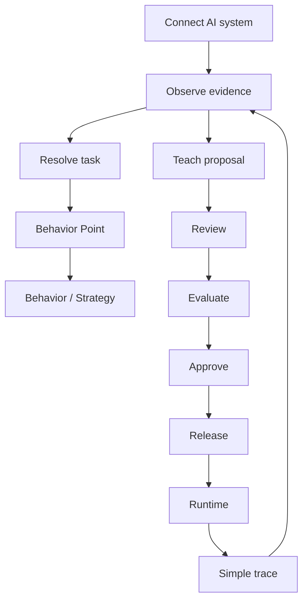

# How Vira works

## Connect

Use the SDK or another supported integration boundary.

## Observe

Send supported model responses, user feedback, and business outcomes.

Observation is evidence. It is not authority.

## Resolve

Semantic resolution identifies an eligible task. A resolver may select, abstain, or return no match.

## Attach behavior

A Behavior Point connects a task to governed behavior.

## Teach

Evidence may produce a proposal.

A proposal is not automatically active.

## Evaluate

Test the candidate.

## Approve

Human or explicit product approval remains a separate gate where required.

## Release

A released artifact becomes eligible for runtime.

## Runtime

The runtime resolves behavior through the governed boundary.

## Trace

A developer sees a compact explanation of what was applied.
