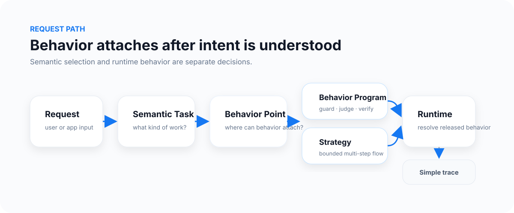
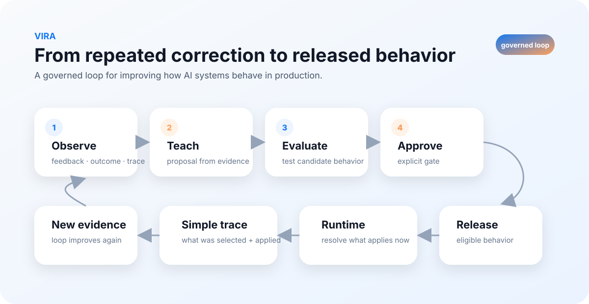

# What is Vira?

**Vira is a behavior-control layer for AI applications and agents.** It helps teams define, review, evaluate, release, and inspect how an existing AI system responds, makes decisions, and uses tools.

An **AI behavior** is what the AI says, decides, and does in a given situation. For example, a finance assistant should not treat a forecast as an actual result; a support agent may need a human handoff before a refund; a research assistant should not invent a citation.

## Why a separate layer?

Without a shared behavior lifecycle, requirements end up scattered among prompts, model wrappers, tool code, tests, and team knowledge. A local fix may not reach another workflow, and a model upgrade may revive an old mistake.

Vira's goal is to make those expectations **explicit operational assets**, with their own identity, tests and release history rather than an accumulation of invisible prompt edits.

## The concepts in one minute

| Concept | Plain-English question it answers |
| --- | --- |
| **Semantic Task** | What kind of work is this request? |
| **Behavior Point** | Where in the application can governed behavior apply? |
| **Behavior Program** | Which rules, judgments, transforms, checks or escalation behavior are intended? |
| **Strategy** | How should bounded steps be coordinated for this task? |
| **Evaluation** | How did this exact candidate perform on selected cases? |
| **Release** | Which approved identity is eligible within this scope? |
| **Runtime resolution** | What eligible behavior can this request use now? |
| **Trace / receipt** | What did this supported operation actually return or select? |
| **Teach** | What reviewable improvement might permitted usage evidence support? |

[Full glossary](core-concepts.md) · [Behavior Points](behavior-points.md) · [Programs](behavior-programs.md)

## Not one complexity level

A simple preference (for example vegetarian, onion-free cooking) can be governed for a single task. A support assistant can keep escalation rules. A business analyst may need consistent metric definitions. A technical agent may require a multi-step strategy or independently authorized sub-tasks.

[Explore 12 examples](use-cases.md) · [Understand execution modes](execution-modes.md) · [Compare with Skills, agents and other platform types](approach-comparison.md)

## Two connected workflows

**Serving requests:** classify work, resolve the relevant Behavior Point, determine eligible released behavior, apply it through a supported model/agent integration, and inspect the returned evidence.

**Improving behavior:** collect permitted evidence, propose a revision, evaluate it, obtain the required review and release decisions, and inspect future runtime outcomes.

The workflows do not automatically authorize each other. A proposed improvement is not a release. A semantic candidate is not runtime permission.

## One grounded scenario

A retail-media copilot compares ROAS across two ad platforms. If the attribution windows or sales definitions differ, the behavior may require that those differences be stated before any budget recommendation. The team can evaluate that requirement on representative cases, explicitly release an approved revision, and record which one the application used.

The **application** still fetches reports, calls the model, and decides whether and how to execute a budget change. Vira does not magically intercept calls that bypass its integration boundary.

## What Vira is, and is not

Vira **is** an operational workflow for governed, reusable behavior across AI applications. It complements prompts, model training, testing, observability, and agent orchestration.

Vira **is not** a foundation model, generic memory store, prompt-writing assistant, universal guardrail, or a guarantee of answer correctness. Model quality, tool permissions, scope, data and integration design remain essential. Benefits must be demonstrated in comparable tests, not assumed.

[Try the local OFF example](start-here.md) · [For developers](developer-guide.md) · [For teams](for-teams.md) · [Capabilities and limits](capability-map.md)
