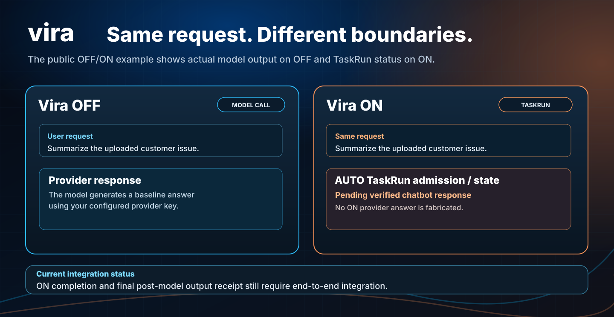

# Next.js + OpenAI Agents: canonical AUTO TaskRun integration



*Conceptual UI illustration. It does not claim a verified ON provider response or a benchmark result.*

This application demonstrates two **different, honest** boundaries. **OFF** runs the configured OpenAI Agent as an ungoverned baseline. **ON** submits the exact user request through the published JavaScript SDK's **AUTO TaskRun** admission. It does **not** directly call `resolveRuntime` or `behavior-projection`, nor does it invoke the provider with a prompt assembled from a projection.

> **Current limitation:** the public TaskRun SDK exposes admission, status, state and events, but not a complete, separately verified final chatbot output handoff. This example displays the actual TaskRun admission/status and does **not** claim an ON chatbot answer until a real provider-output and post-model verification receipt is available. It does not fake completion or quietly fall back to OFF.

## Run locally

Use Node.js 22.6+:

```bash
cd examples/frameworks/node-next
npm ci
cp .env.example .env.local
# Configure OPENAI_API_KEY for OFF baseline.
npm run dev
```

Open the local URL printed by Next.js. OFF sends your input to the configured model. The route is meant for local development, is **not authenticated for end users**, and should not be deployed publicly without identity, rate limiting and authorization controls.

## Test ON with a provisioned Vira tenant

Set `VIRA_API_URL`, `VIRA_API_KEY`, `VIRA_ORGANIZATION_ID`, `VIRA_PROJECT_ID`, `VIRA_ENVIRONMENT_ID` and the real `VIRA_CONNECTION_ID` on the **server only**. The account must have an eligible released Task/Behavior and the server-attested host capabilities for any Strategy or Compound execution.

Use the same prompt in ON:

1. The chat route submits `startTaskRun` with `requestedMode: "AUTO"`, bounded budget, unique idempotency identity and the real connection ID when configured.
2. The server performs semantic routing, selects the eligible execution mode and admits/persists a TaskRun. It may reject or abstain, which is a valid outcome.
3. The route reads the persisted TaskRun state and returns HTTP 202 **pending verified chatbot response**. It does not create a provider answer or post-model receipt.
4. The UI displays selected mode and persisted status, **not** a fabricated ON response.

A released Pack is not sufficient by itself to guarantee a live chat response: the provider and post-model verifier must be integrated into the same canonical boundary.

## Try examples at different levels

| Example user input | Related behavior source |
| --- | --- |
| “Suggest a four-person eggplant dinner.” | [Recipe preferences Pack](../../packs/recipe-preferences/README.md) |
| “Compare ROAS from 7-day click vs 30-day click plus view.” | [Retail-media Pack](../../packs/retail-media-review/README.md) |
| “Investigate support complaints and inventory risk.” | [Operations Pack](../../packs/operations-orchestration/README.md) |

These inputs are illustrative. The relevant task needs to be actually registered, evaluated and released in the account for routing to select it. There is no hard-coded fake behavior data in this example.

## Creating or reusing a scoped connection

When authorized for a non-production environment, set `VIRA_TUTORIAL_NON_PRODUCTION=true`, `VIRA_ALLOW_CONNECT=true` and a unique `VIRA_CONNECT_IDEMPOTENCY_KEY`, then run `npm run vira:connect`. Use the actual returned connection ID. These environment flags are assertions by the operator, not security controls that verify the remote deployment.

## Contract and testing

```bash
npm test
npm run build
```

The unit tests verify OFF has no Vira dependency, ON submits AUTO TaskRun, no direct projection call occurs, no provider call bypasses verification, and denied/missing configuration fails closed. **Tests use synthetic transport responses** to exercise the application boundary; they are not a live Vira tenant, provider or verifier acceptance.

For the complete intended request path and missing last-mile integration, see [canonical AUTO TaskRun](../../../docs/canonical-taskrun.md) and [per-example verification](../../../docs/example-verification.md). For low-level diagnostic APIs, see [Runtime](../../../docs/runtime.md).

This example does not use tools or perform external effects. Do not put secrets in browser code or logs.
