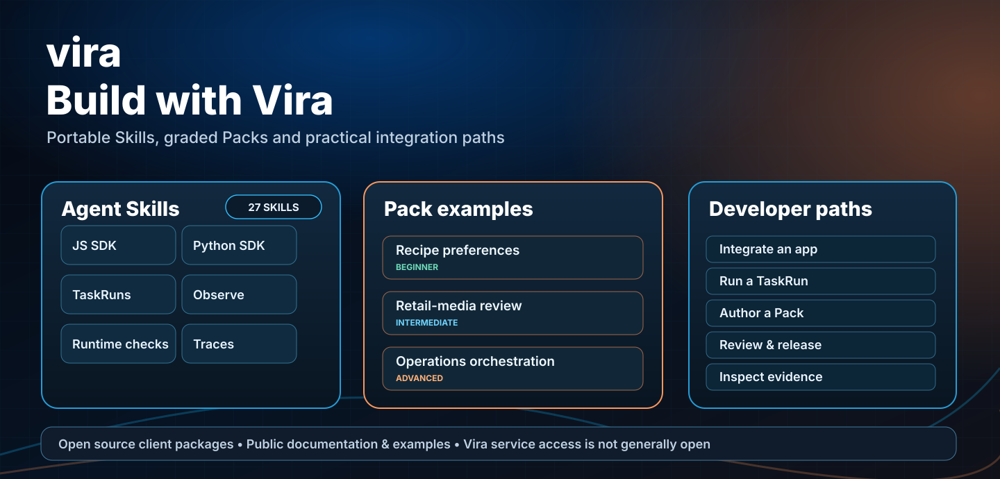

# Pack Academy · Four versioned behavior examples



These are complete, inspectable source Packs, not successful model benchmarks or released customer configurations. They contain **108 design-time evaluation cases** spanning clear tasks, contradictions, missing evidence, calculation and authorization boundaries.

| Level | Pack | Cases | What it evaluates |
| --- | --- | ---: | --- |
| Beginner | [Recipe preferences](recipe-preferences/README.md) | 26 | Standing constraints, hidden ingredients, practical substitutions |
| Intermediate | [Retail-media review](retail-media-review/README.md) | 27 | Numerically correct and comparable KPI decisions |
| Intermediate | [Marketing launch decision](marketing-starter/README.md) | 26 | Constraints, hypotheses, experiment priorities and approvals |
| Advanced | [Operations orchestration](operations-orchestration/README.md) | 29 | Source facts, blocked children, and structured read-only Strategy |

Each Pack has a YAML manifest and JSON collections for Tasks, Points, Programs, signals, evaluations and tests. The Operations Pack also has a Strategy graph. Imported ZIPs omit the design-time `tests/cases.json` records.

The Programs declare semantic `judge: ...` checks, which require an **actual configured verifier**. They do not become executable just by appearing in a JSON file. The static CI tests validate schemas, links and packaging, not observed model performance.

## Package all four

```bash
npm run verify:packs
python3 scripts/package-example-packs.py --out /tmp/vira-example-packs
```

## Compare real model behavior

Create a blank reviewer template and fill it with genuine OFF/ON model responses:

```bash
node scripts/score-pack-comparison.mjs --pack retail-media-review --template /tmp/retail-review.jsonl
node scripts/score-pack-comparison.mjs --pack retail-media-review --responses /tmp/retail-review.jsonl --out /tmp/retail-report.json
```

The [evaluation guide](../../docs/pack-evaluation.md) explains evidence provenance, manual/independent review, and missing or unverifiable cases. A TaskRun admission is not a verified answer. Actual authorization, model and verifier access remain deployment-specific.

[Pack authoring](../../docs/pack-authoring-guide.md) · [Runtime verification](../../docs/runtime-verification.md) · [TaskRun](../../docs/canonical-taskrun.md)
