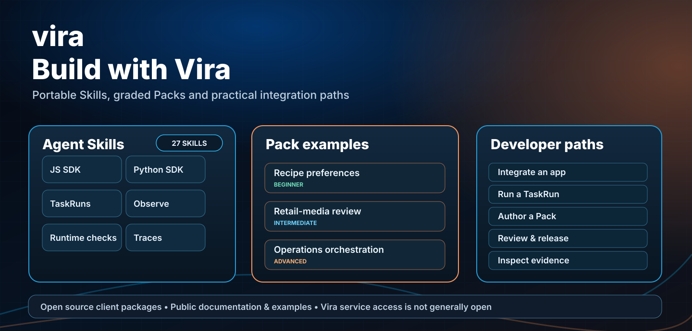

# Vira Agent Skills

Portable, licensed Agent Skills for integrating with and operating Vira through documented public surfaces. The 27-Skill library is in active development and is not yet published to skills.sh.



## Installation and usage rights

The [Vira Agent Skill Installation & Application Use License](vira-observe/LICENSE)
expressly permits installation, modification, distribution inside application
repositories and **commercial/client integration work**, with attribution.
It does not license the private backend, Vira hosted service or trademarks.

For an offline-contained instructional archive, run
`python3 scripts/package_agent_skills.py --out /tmp/tryvira-skills`
from the public repository and verify all 27 archives using
`python3 scripts/verify_portable_skills.py /tmp/tryvira-skills --expected 27`.
Archives mirror linked public source resources and selected runnable example folders under `references/repo/`;
Pack, Framework, Chatbot and TaskRun Skills include needed standalone source examples and builder scripts. Run them from the local `references/repo/` path. npm/PyPI SDK dependencies and real Vira service access remain external.

[Skill tests and compatibility](../docs/agent-skills/e2e-readiness.md) ·
[Model-selection evaluation](../docs/agent-skills/live-acceptance.md).

## Install

From the target application repository, install one skill from this public repository’s `main` branch:

```bash
npx skills add hrpering/tryvira --skill vira-js-sdk
```

To try the local chatbot with Vira OFF/ON, install its guide:

```bash
npx skills add hrpering/tryvira --skill vira-chatbot
```

Install the full library by omitting `--skill` or select the target agent in the CLI. See [installation and compatibility details](../docs/agent-skills/installation.md). For a local checkout, point your agent at `skills/` or copy the selected skill folder into its supported skills directory.

For a published JavaScript or Python TaskRun workflow, install `vira-task-runs` alongside the matching SDK Skill:

```bash
npx skills add hrpering/tryvira --skill vira-task-runs
```

## Skills

| Skill | Use it for |
| --- | --- |
| `vira-observe` | Observe-only instrumentation: model/tool/action/feedback events and scoped ingestion |
| `vira-runtime-verification` | Implement and inspect verification using documented check and receipt contracts |
| `vira-traces` | TaskRun/child authority, verification receipt and outcome lineage diagnostics |
| `vira-get-started` | Inspect a project and choose the supported integration path |
| `vira-npm-cli` | Install/upgrade npm SDK and MCP package safely |
| `vira-integrate-app` | Select the appropriate documented integration surface |
| `vira-js-sdk` | JavaScript/TypeScript SDK implementation |
| `vira-task-runs` | JavaScript and Python SDK TaskRun routing, admission, readback, and state transitions |
| `vira-python-sdk` | Python SDK implementation |
| `vira-mcp` | Published MCP configuration and runtime tool discovery |
| `vira-http-api` | HTTP operations, auth, and scope |
| `vira-framework-integration` | Framework-native integration using supported SDK contracts |
| `vira-author-behavior` | Semantic Tasks, Behavior Points, Programs, Strategies |
| `vira-signals` | Consent-aware signal discovery, review, materialization, and producer mapping |
| `vira-strategies` | Strategy validation, simulation, activation, and execution continuation |
| `vira-build-pack` | Build and validate a Pack candidate |
| `vira-packs` | Pack import, install/materialization, evaluation, approval, release |
| `vira-observe-teach` | Evidence, Teach analysis/readback, recommendation decisions, and proposal lifecycle |
| `vira-evaluate` | Build and review synthetic evaluations and response quality checks |
| `vira-evaluate-release` | Evaluation, approval, and release boundaries |
| `vira-release` | Prepare explicit approval/release/deployment verification |
| `vira-runtime` | Governed runtime resolution, execution, receipts |
| `vira-chatbot` | Run the local Next.js OFF baseline and ON TaskRun admission demo |
| `vira-studio` | Studio workflow guidance and access-state caveats |
| `vira-debug` | Surface-specific troubleshooting |
| `vira-lifecycle` | End-to-end behavior lifecycle planning |
| `vira-full-lifecycle` | Orchestrate a complete governed user workflow |

Shared sources: [capability matrix](../references/capability-matrix.md), [authority and safety](../references/authority-and-safety.md), [coverage and validation report](../docs/agent-skills/validation-status.md), [maintenance process](../docs/agent-skills/maintenance.md). These skills distinguish SDK, Python, HTTP, MCP, and Studio capability. MCP tools must be discovered at runtime; SDK operations are not automatically MCP tools.

For the complete customer journey, use `vira-full-lifecycle` with `vira-observe`, `vira-signals`, `vira-runtime-verification`, `vira-traces` and `vira-observe-teach` as needed. The [Teach guide](../docs/teach.md) and [Marketing Agent tutorial](../tutorials/marketing-agent/README.md) walk through a real configured service, from permitted evidence and behavior review through runtime use and the next learning cycle. Each Skill folder includes a task-specific example or guide; the [coverage report](../docs/agent-skills/skill-status.md) distinguishes runnable examples from workflow guidance and unavailable product access.

## One canonical user-facing execution path

**AUTO TaskRun → semantic resolve → eligible mode dispatch → real child executor → runtime enforcement → provider/chatbot → post-model verification → receipt.**

`vira-task-runs` covers both published JavaScript and Python SDKs. `vira-runtime-verification` covers actual checks and the known missing final-answer readback contract. `vira-observe` collects real events separately; `vira-signals` gives typed versioned evidence a governed mapping; `vira-traces` inspects real receipts. Normal chatbot requests use AUTO TaskRun; `resolveRuntime` and `behavior-projection` are advanced diagnostic interfaces.

[Integration compatibility](../docs/agent-skills/production-contract-audit.md) · [Client method reference](../docs/agent-skills/production-contract-baseline.md) · [Three graded Pack examples](../examples/packs/README.md).

## Runnable operation examples

- `vira-evaluate/examples/` includes a Pack-bound Behavior Evaluation runner. Live writes require explicit non-production and mutation flags.
- `vira-observe-teach/examples/` includes asynchronous Teach analysis creation/readback. Live writes require explicit non-production and mutation flags.
- `vira-chatbot/examples/` explains how to run the real local chatbot in OFF mode and, with the user's own access, ON mode.

The two runnable mutation runner examples require an operator-provided `VIRA_API_URL` and server-side credential, and call the configured Vira API through the published SDK. Never put credentials in prompts, source control, or logs. A run reports only the server state it reads; queued work is not a completed result.

The TaskRun Skill has [actual JS](../examples/javascript/taskrun-modes.mjs) and [actual Python](../examples/python/taskrun_modes.py) route-first examples; both require an authorized non-production account for admission. The public Next.js ON demo shows TaskRun status and **does not** claim a verified final provider output.

## Validation state

Package selected skills as Anthropic-compatible `.skill` ZIP files with `python3 scripts/package_agent_skills.py vira-js-sdk` (archives are written to ignored `dist/skills/`). Export Anthropic `run_eval.py`-compatible binary trigger cases with `python3 scripts/export_skill_trigger_eval.py vira-js-sdk --out /tmp/vira-js-sdk-evals.json --ambiguous-out /tmp/vira-js-sdk-ambiguous.json`. Run the upstream evaluator only when Claude Code CLI is installed and configured. Run `python3 scripts/validate_agent_skills.py` and `python3 -m unittest discover -s skills/evals -v` from the repository root. The trigger dataset contains positive, negative, and ambiguous prompts for each Skill; `skills/evals/workflow-scenarios.jsonl` adds synthetic lifecycle execution cases with expected and forbidden behaviors. Offline checks do not prove model-trigger quality, live API behavior, package publication, or Studio access. Official OpenAI and Anthropic structural validators were run for an earlier version of the library, not this 27-Skill revision. No external model evaluation or live Vira service call is claimed. The Skills are not listed in the skills.sh directory, and no separate `.skill` archive release is claimed.
