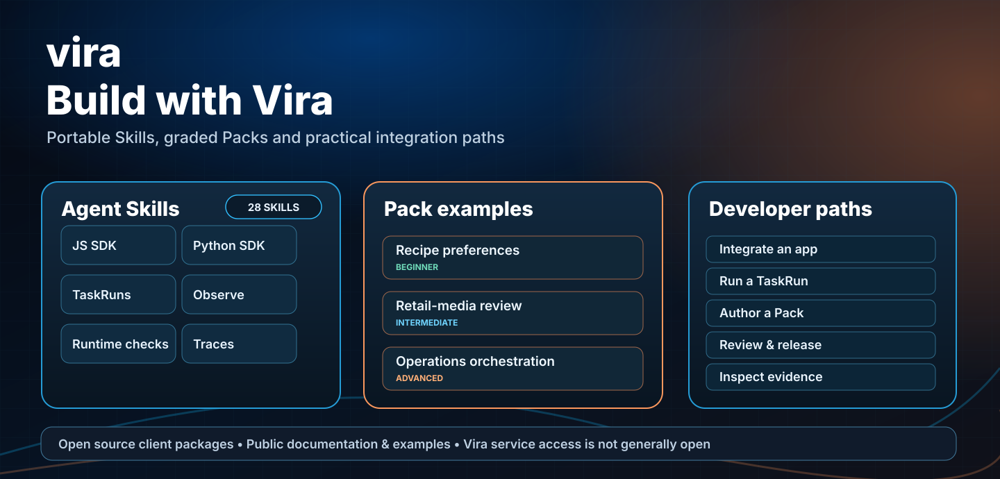

# Vira Agent Skills

Install the **one public `vira` root Skill** for the full agent-first workflow. It coordinates the 28 specialist domains within a single self-contained instruction file, while the original 28 specialist Skills remain optional advanced references. A single root Skill is not 28 independently installed packages, and installing it does not install SDKs or a Vira service.



## Demonstrate the Skills in one real workflow

Do not start by listing 28 names. A Skill teaches a coding assistant how to author, integrate and evaluate Vira; the **Vira service** governs actual execution and records receipts. These are different jobs.

1. Install just the root `vira` Skill; consult specialized source guides only when more detail is useful.
2. Use the included public Pack examples to create a new, separately validated candidate with positive, negative and missing-data cases.
3. If authorized development access is available, request AUTO TaskRun and inspect actual selected mode, child state and receipts. Otherwise stop at the local evidence level.
4. Explain Teach as a distinct evidence-to-reviewed-revision cycle, not an automatic release.

[Step-by-step screen recording](../docs/agent-skills/video-workflow.md) · [Production-alignment gap matrix](../docs/agent-skills/production-parity-demo.md)


## Installation and usage rights

The [Vira Agent Skill Installation & Application Use License](vira-observe/LICENSE)
expressly permits installation, modification, distribution inside application
repositories and **commercial/client integration work**, with attribution.
It does not license the private backend, Vira hosted service or trademarks.

For an offline-contained instructional archive, run
`python3 scripts/package_agent_skills.py --out /tmp/tryvira-skills`
from the public repository and verify all 28 archives using
`python3 scripts/verify_portable_skills.py /tmp/tryvira-skills --expected 28`.
Archives mirror linked public source resources and selected runnable example folders under `references/repo/`;
Pack, Framework, Chatbot and TaskRun Skills include needed standalone source examples and builder scripts. Run them from the local `references/repo/` path. npm/PyPI SDK dependencies and real Vira service access remain external.

[Public E2E completion plan](../docs/agent-skills/e2e-completion-plan.md) · [Example package versions](../docs/example-package-compatibility.md) · [Skill tests and compatibility](../docs/agent-skills/e2e-readiness.md) ·
[Model-selection evaluation](../docs/agent-skills/live-acceptance.md).

## Install

From the target application, install the complete default agent-facing workflow as **one Skill**:

```bash
npx skills add hrpering/tryvira --skill vira
```

The root `SKILL.md` is self-contained even when the CLI only copies that file. Its built-in router covers all 28 specialist categories. For expert-only deep dives, select a specialist's direct GitHub path, e.g. `npx skills add https://github.com/hrpering/tryvira/tree/main/skills/vira-build-pack`; this is optional and does not change the default `vira` installation.

To try the local chatbot with Vira OFF/ON, start with the root `vira` Skill and the [Next.js example](../examples/frameworks/node-next/README.md).

Installing from the repository root should select the root `vira` Skill by default. The 28 specialist Skill directories remain in this repository for advanced direct-path use and for their independently verified archives. See [installation and compatibility details](../docs/agent-skills/installation.md).

For JavaScript/Python/MCP TaskRun workflows, the root Skill discovers the installed SDK method or live MCP tools and handles the route/admission/readback boundaries. Optional specialist reference: [vira-task-runs](vira-task-runs/SKILL.md).

## Default: agent-first operations

Prefer `vira-mcp` and the task-specific Skill when the host exposes the Vira MCP server; discover the live tool schema. For unavailable MCP operations, use `vira-operator` with the customer's installed `@tryvira/sdk`, or the supported Python SDK in Python projects. Both paths use Vira's canonical scope, authority and real server readback; switching surfaces never bypasses a denied operation. See the [common operation flow](../docs/agent-first-operation-flow.md). Studio-only operations remain listed as gaps instead of being faked. See the [Studio-less parity ledger](../docs/agent-skills/studio-less-parity.md).

~~~bash
npx skills add hrpering/tryvira --skill vira
~~~

## Skills

| Skill | Use it for |
| --- | --- |
| `vira-operator` | Version-matched JavaScript SDK fallback for absent MCP tools, with scoped approval and persisted readback |
| `vira-observe` | Observe-only instrumentation: model/tool/action/feedback events and scoped ingestion |
| `vira-runtime-verification` | Implement and inspect verification using documented check and receipt contracts |
| `vira-traces` | TaskRun/child authority, verification receipt and outcome lineage diagnostics |
| `vira-get-started` | Inspect a project and choose the supported integration path |
| `vira-npm-cli` | Install/upgrade npm SDK and MCP package safely |
| `vira-integrate-app` | Select the appropriate documented integration surface |
| `vira-js-sdk` | JavaScript/TypeScript SDK implementation |
| `vira-task-runs` | JavaScript and Python SDK TaskRun routing, admission, readback, and state transitions |
| `vira-python-sdk` | Python SDK implementation |
| `vira-mcp` | Published MCP configuration and runtime tool discovery |
| `vira-http-api` | HTTP operations, auth, and scope |
| `vira-framework-integration` | Framework-native integration using supported SDK contracts |
| `vira-author-behavior` | Semantic Tasks, Behavior Points, Programs, Strategies |
| `vira-signals` | Consent-aware signal discovery, review, materialization, and producer mapping |
| `vira-strategies` | Strategy validation, simulation, activation, and execution continuation |
| `vira-build-pack` | Build and validate a Pack candidate |
| `vira-packs` | Pack import, install/materialization, evaluation, approval, release |
| `vira-observe-teach` | Evidence, Teach analysis/readback, recommendation decisions, and proposal lifecycle |
| `vira-evaluate` | Build and review synthetic evaluations and response quality checks |
| `vira-evaluate-release` | Evaluation, approval, and release boundaries |
| `vira-release` | Prepare explicit approval/release/deployment verification |
| `vira-runtime` | Governed runtime resolution, execution, receipts |
| `vira-chatbot` | Run the local Next.js OFF baseline and ON TaskRun admission demo |
| `vira-studio` | Studio workflow guidance and access-state caveats |
| `vira-debug` | Surface-specific troubleshooting |
| `vira-lifecycle` | End-to-end behavior lifecycle planning |
| `vira-full-lifecycle` | Orchestrate a complete governed user workflow |

For package source/registry version differences and OpenCode approval limitations, see the [integration compatibility guide](../docs/integration-compatibility.md). MCP canonical names may differ from older callable aliases; always follow the live tool catalog.

Shared sources: [capability matrix](../references/capability-matrix.md), [authority and safety](../references/authority-and-safety.md), [coverage and validation report](../docs/agent-skills/validation-status.md), [maintenance process](../docs/agent-skills/maintenance.md). These skills distinguish SDK, Python, HTTP, MCP, and Studio capability. MCP tools must be discovered at runtime; SDK operations are not automatically MCP tools.

For the complete customer journey, use `vira-full-lifecycle` with `vira-observe`, `vira-signals`, `vira-runtime-verification`, `vira-traces` and `vira-observe-teach` as needed. The [Teach guide](../docs/teach.md) and [Marketing Agent tutorial](../tutorials/marketing-agent/README.md) walk through a real configured service, from permitted evidence and behavior review through runtime use and the next learning cycle. Each Skill folder includes a task-specific example or guide; the [coverage report](../docs/agent-skills/skill-status.md) distinguishes runnable examples from workflow guidance and unavailable product access.

## One canonical user-facing execution path

**AUTO TaskRun → semantic resolve → eligible mode dispatch → real child executor → runtime enforcement → provider/chatbot → post-model verification → receipt.**

`vira-task-runs` covers both published JavaScript and Python SDKs. `vira-runtime-verification` covers actual checks and the known missing final-answer readback contract. `vira-observe` collects real events separately; `vira-signals` gives typed versioned evidence a governed mapping; `vira-traces` inspects real receipts. Normal chatbot requests use AUTO TaskRun; `resolveRuntime` and `behavior-projection` are advanced diagnostic interfaces.

[Integration compatibility](../docs/agent-skills/production-contract-audit.md) · [Client method reference](../docs/agent-skills/production-contract-baseline.md) · [Three graded Pack examples](../examples/packs/README.md).

## Runnable operation examples

- `vira-evaluate/examples/` includes a Pack-bound Behavior Evaluation runner. Live writes require explicit non-production and mutation flags.
- `vira-observe-teach/examples/` includes asynchronous Teach analysis creation/readback. Live writes require explicit non-production and mutation flags.
- `vira-chatbot/examples/` explains how to run the real local chatbot in OFF mode and, with the user's own access, ON mode.

The two runnable mutation runner examples require an operator-provided `VIRA_API_URL` and server-side credential, and call the configured Vira API through the published SDK. Never put credentials in prompts, source control, or logs. A run reports only the server state it reads; queued work is not a completed result.

The TaskRun Skill has [actual JS](../examples/javascript/taskrun-modes.mjs) and [actual Python](../examples/python/taskrun_modes.py) route-first examples; both require an authorized non-production account for admission. The public Next.js ON demo shows TaskRun status and **does not** claim a verified final provider output.

## Validation state

Package selected skills as Anthropic-compatible `.skill` ZIP files with `python3 scripts/package_agent_skills.py vira-js-sdk` (archives are written to ignored `dist/skills/`). Export Anthropic `run_eval.py`-compatible binary trigger cases with `python3 scripts/export_skill_trigger_eval.py vira-js-sdk --out /tmp/vira-js-sdk-evals.json --ambiguous-out /tmp/vira-js-sdk-ambiguous.json`. Run the upstream evaluator only when Claude Code CLI is installed and configured. Run `python3 scripts/validate_agent_skills.py` and `python3 -m unittest discover -s skills/evals -v` from the repository root. The trigger dataset contains positive, negative, and ambiguous prompts for each Skill; `skills/evals/workflow-scenarios.jsonl` adds synthetic lifecycle execution cases with expected and forbidden behaviors. Offline checks do not prove model-trigger quality, live API behavior, package publication, or Studio access. Official OpenAI and Anthropic structural validators were run for an earlier version of the library, not this 28-Skill revision. No external model evaluation or live Vira service call is claimed. The Skills are not listed in the skills.sh directory, and no separate `.skill` archive release is claimed.
